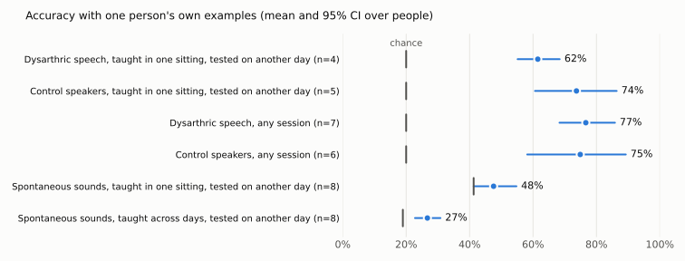
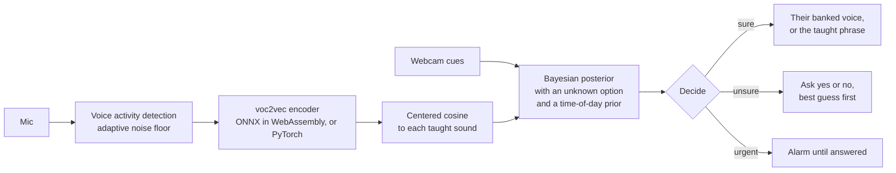

# Tink

**Learns the few sounds a person who has lost their speech can still make, and says what each one means out loud, in their own banked voice. The model runs in the browser, so no audio leaves the device.**

[](https://github.com/hammy229/tink/actions/workflows/ci.yml)
[](LICENSE)

**Links:** [Live demo](https://tink-quen.vercel.app/#demo) · [Full results](docs/results.md) · [How accuracy was measured](docs/accuracy.md) · [Model card](docs/model-card.md) · [Design decisions](docs/adr) · [Arham Doshi](https://arhamdoshi.dev) · [LinkedIn](https://linkedin.com/in/arhamdoshi)

**[Try it in your browser](https://tink-quen.vercel.app/#demo).** No install and no account. The model runs on your device, so no audio is uploaded.

**It hasn't been tested with a nonspeaking person using it.** Everything below comes from existing datasets.

## Results

Teaching each sound takes a few recordings from one person, with no training across people. The main question is what happens when someone teaches it once and uses it on another day.



<!-- results:start -->
| Benchmark | People | Accuracy | Chance | Right within 2 questions |
|---|---|---|---|---|
| Dysarthric speech, taught in one sitting, tested on another day | 4 | 61.5% [55.1, 68.4] | 20.0% | 83.6% |
| Control speakers, taught in one sitting, tested on another day | 5 | 73.7% [60.6, 86.4] | 20.0% | 85.3% |
| Dysarthric speech, any session | 7 | 76.6% [68.3, 85.8] | 20.0% | 88.5% |
| Control speakers, any session | 6 | 74.9% [58.2, 89.3] | 20.0% | 85.6% |
| Spontaneous sounds, taught in one sitting, tested on another day | 8 | 47.6% [41.3, 54.8] | 41.3% | 81.8% |
| Spontaneous sounds, taught across days, tested on another day | 8 | 26.7% [22.8, 30.8] | 19.0% | 47.7% |
<!-- results:end -->

So there's a real signal on deliberate sounds, though the top row has only 4 people. Spontaneous sounds mostly don't carry their meaning, and Tink isn't reliable enough to depend on alone. That's why it asks when it's unsure, and the "within 2 questions" column is why asking helps so much.

Full results are in [docs/results.md](docs/results.md), which is generated from the raw JSON, and a test fails if the two disagree. How I measured it and what it can't tell you: [docs/accuracy.md](docs/accuracy.md). Model details: [docs/model-card.md](docs/model-card.md).

### Decisions the data changed

These are the parts I'd most want to talk about, as most of them are things I got wrong first.

- **My own benchmark was hiding the real number.** A first version let each word be taught on a different day and scored 42%. Teaching in one sitting, as the app does, scored 62%. The earlier design let a session stand in for a word.
- **I shipped a feature and then removed it.** Letting a caregiver's "Right" teach Tink looked like +2.3 points, so I built it. A review showed my simulation could help a clip with a near copy of itself. Done in time order, it [loses 7.0 points](docs/adr/0005-do-not-learn-from-confirmed-sounds.md) on deliberate sounds, p = 0.004.
- **I trained a head and didn't use it.** A prototypical network head won on one dataset and lost on the other, and I'd set the rule before running it: [it has to win on both](docs/adr/0004-do-not-ship-the-trained-head.md).
- **One dataset would have picked the wrong model.** Cutting the model down to its front end looked 0.9 points better on ReCANVo, and it [loses 4.8 on dysarthric speech](docs/adr/0002-ship-the-full-depth-model.md).
- **The bigger number wasn't the right choice.** HuBERT beats voc2vec by about 9 points on words, and voc2vec wins on non-verbal sound, so [I kept voc2vec](docs/adr/0003-keep-voc2vec-over-hubert.md), since Tink is for sounds that aren't words.

All of the ADRs are in [docs/adr](docs/adr).

## Why it matters

Tink learns the sounds one person can still make (a hum, two clicks, a sigh) and says out loud what each one means. It's for people who can make sounds but not words: people losing their speech to ALS, stroke survivors, minimally speaking autistic people. While someone can still speak, they can bank their own voice saying each phrase, and Tink plays that recording instead of a computer voice.

It started as my HackTX 26 project. I kept going to find out whether it actually works, and to build it the way it would need to be built if someone relied on it.

## How it works



There are two ways to run the same logic:

- **In the browser** (`web/engine/`): the model runs in a Web Worker with ONNX Runtime Web, and sounds are kept in IndexedDB. Nothing leaves the device.
- **On a server** (`tink/`): FastAPI with per-person profiles, plus a WebSocket for devices with no screen.

Two implementations can drift apart, so a fixture generated from the Python code is checked by both pytest and `node:test`.

| Area | What's there | Evidence |
|---|---|---|
| **Model deployment** | ONNX export, int8 quantization from 378 MB to 122 MB, hash-pinned download | Loses about 0.1 points against PyTorch on the real benchmarks. 143 ms per embedding in WebAssembly. A test blocks pinning a model with no passing report. |
| **Evaluation** | Paired comparisons, person-level bootstrap, exact sign-flip test, calibration, conformal, label-shuffle check, promotion gates | [results.md](docs/results.md) |
| **Local first, server when unsure** | A benchmark of answering on the device and sending only unsure sounds to a full-precision model on a server, with each person's threshold set from other people ([evals/routing.py](evals/routing.py)) | On dysarthric speech, sending 25% of sounds gets 60% of the server's gain, 76.5% to 81.8% against 85.3%, and beats sending as many at random. The share each person sends ranges from 0% to 55%. |
| **Concurrency** | Inference on worker threads, a lock per person, one lock around the model ([ADR 6](docs/adr/0006-inference-off-the-event-loop.md)) | With 16 clients on one laptop: 58 requests per second, p95 342 ms, no errors, and `/healthz` p95 3 ms while the model is busy. |
| **Real time** | Voice activity detection that learns the room's noise floor, so someone who can't press a button can use it | Tested on a scripted stream with a fan, and end to end in Chromium. |
| **Reliability** | Atomic writes, embeddings cached by model, requests queued in the browser, recovery from a dead worker or corrupt cache | A test proves a crash mid-write keeps the old file. |
| **Security and privacy** | Content security policy, SRI, upload limits checked before decoding, stream limits, rate limits that forged headers can't dodge, no phrases in logs | The end-to-end test checks that no request carries audio, and serves production's real headers. |

## Tech stack

Python, FastAPI, PyTorch, voc2vec (HuBERT-based), ONNX Runtime Web in a Web Worker, int8 quantization, IndexedDB, plain HTML, CSS, and JavaScript, pytest, `node:test`, Playwright with Chromium, uv, Docker, Vercel, GitHub Actions.

## Getting started

The browser version needs nothing. To run the server, you need [uv](https://docs.astral.sh/uv/). The first run downloads the model (about 360 MB).

```bash
uv sync
uv run uvicorn tink.app:app --reload     # then open http://localhost:8000 in Chrome
```

1. **Teach a sound:** say what it sounds like and what it means, then record it about 5 times. Teach at least 2.
2. **Bank their voice:** while the person can still speak, record them saying each phrase.
3. **Listen:** press Listen or space, or turn on **Keep listening** to go hands-free.
4. **Room noise:** record the room with nobody making a sound, so Tink ignores it.
5. **Yes and no:** teach a yes sound and a no sound, and Tink asks about one meaning at a time when it's unsure.
6. **Urgent:** mark a sound as urgent, and Tink skips the questions and repeats the phrase until someone answers.

To stream from a device with no screen, send 16 kHz mono 16-bit PCM to `ws://host/api/listen` and get one JSON turn back per sound. API docs are at `/docs` on a running server.

### Settings

| Env var | Default | What it does |
|---|---|---|
| `TINK_MODEL` | `alkiskoudounas/voc2vec-hubert-ls-pt` | Encoder. `facebook/hubert-base-ls960` does better on spoken words. |
| `TINK_ONNX` | unset | Path to an exported model. Serves without torch. |
| `TINK_LAYER` | `-1` | Hidden layer to pool |
| `TINK_DATA` | `data` | Where takes and profiles live |
| `TINK_AUGMENT` | `1` | Add 4 variants per take |
| `TINK_PUBLIC` | unset | `1` turns on per-person profiles with private links, for hosting (see [docs/deploy.md](docs/deploy.md)) |
| `TINK_TRUST_PROXY` | unset | `1` only behind a proxy you run |
| `XAI_API_KEY` | unset | Optional LLM wording and translation, off by default. Without it, no text or audio goes anywhere. |

## Project structure

```
tink/         server: audio, embeddings, scoring, Bayes, turn decisions, voice activity, API
web/engine/   the same logic in the browser, the model worker, and the local API
web/          the site and app (plain HTML, CSS, and JS, no build step)
evals/        benchmarks, metrics, the trained head, the model gate, and the report
scripts/      ONNX export, load test, parity fixture
tests/ e2e/   pytest, and the real model in real Chromium
docs/         results, accuracy, model card, ADRs
```

## Testing

```bash
uv run pytest        # server, evals, and parity tests
npm test             # browser engine and parity tests
npm run e2e          # the real model in real Chromium
```

- 100+ pytest tests, parity tests, a real-model browser test, CI with lint, types, coverage, and commit checks.

To reproduce every number in Results from the datasets:

```bash
uv run --group eval python -m evals.embed recanvo path/to/ReCANVo
uv run --group eval python -m evals.embed torgo path/to/TORGO
uv run --group eval python -m evals.run --recanvo path/to/ReCANVo --torgo path/to/TORGO
uv run --group eval python -m evals.render

uv run --group export python -m scripts.export_onnx --layers 12 --clips path/to/wavs
uv run --group eval --group export python -m evals.onnx_gate models/voc2vec-l12.int8.onnx --layer 12 --recanvo path/to/ReCANVo --torgo path/to/TORGO
uv run --group eval python -m evals.routing --recanvo path/to/ReCANVo --torgo path/to/TORGO
uv run --group eval python -m evals.render
```

## Limitations and next steps

- It has not been tested with a nonspeaking person using it. Every number comes from existing datasets.
- The strongest result, deliberate sounds on another day, comes from only 4 dysarthric speakers.
- Spontaneous sounds mostly do not carry their meaning, so Tink asks when unsure and is not reliable enough to depend on alone.
- How it was measured and what the numbers cannot tell you: [docs/accuracy.md](docs/accuracy.md). Model details: [docs/model-card.md](docs/model-card.md).

## License

MIT, see [LICENSE](LICENSE). Built by [Arham Doshi](https://arhamdoshi.dev).

Built on [voc2vec](https://ieeexplore.ieee.org/document/10890672) (Koudounas et al., ICASSP 2025, Apache 2.0). Evaluated on [ReCANVo](https://doi.org/10.5281/zenodo.5786860) (Narain and Johnson, 2021) and [TORGO](https://www.cs.toronto.edu/~complingweb/data/TORGO/torgo.html) (Rudzicz, Namasivayam, and Wolff, 2012, doi:10.1007/s10579-011-9145-0). The hackathon write-up is in [docs/archive](docs/archive).
